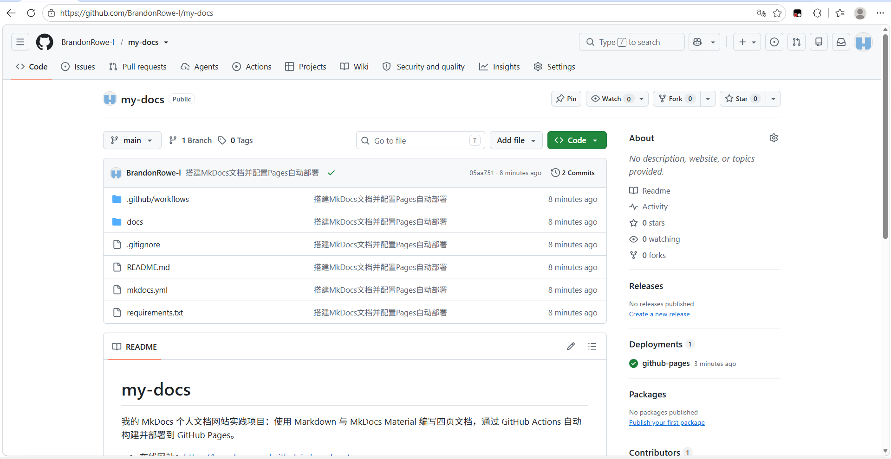
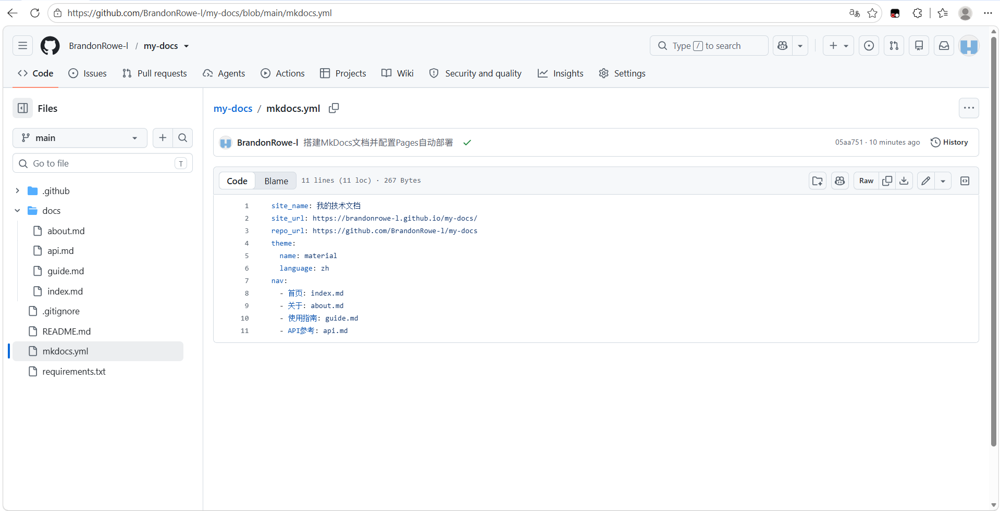
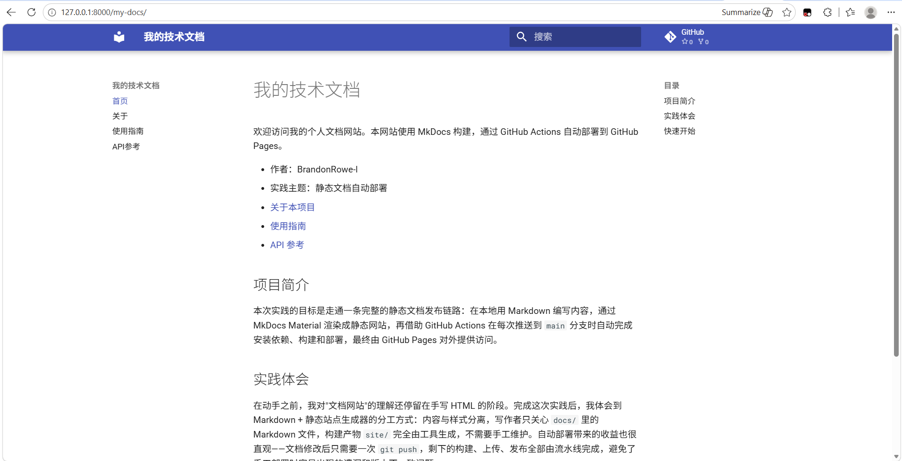
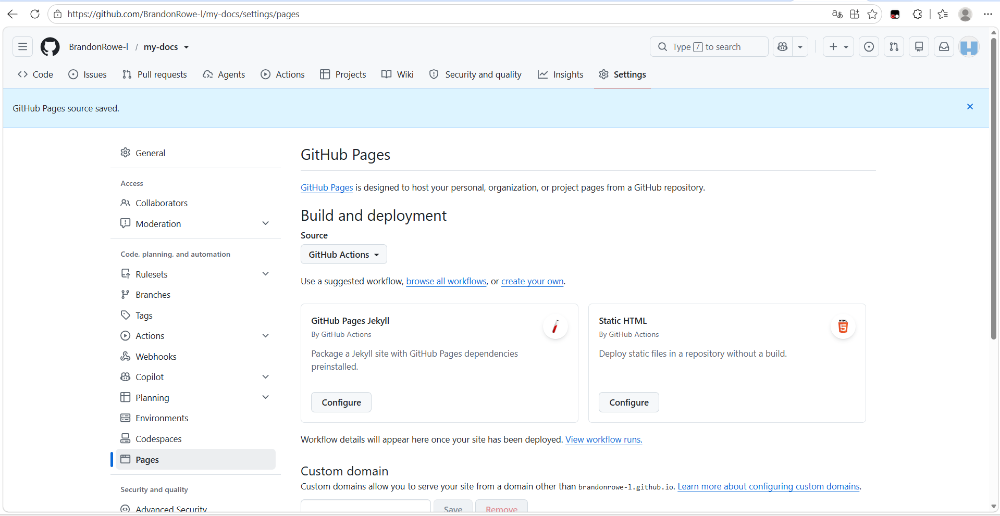
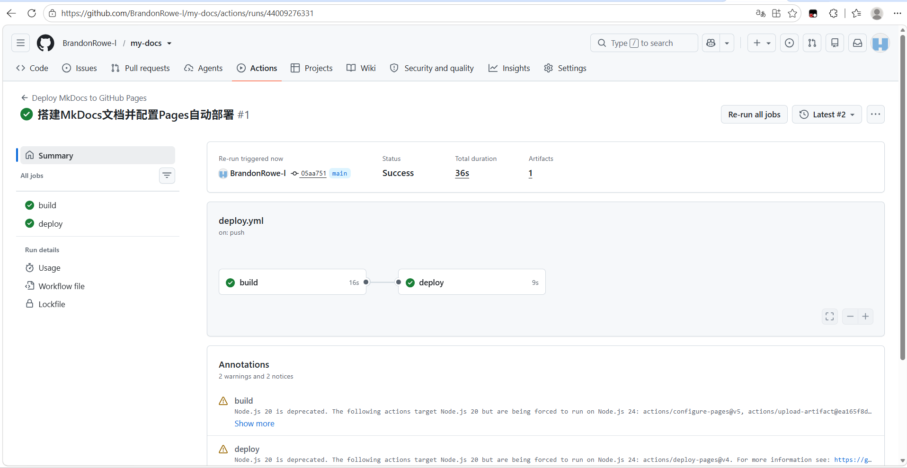
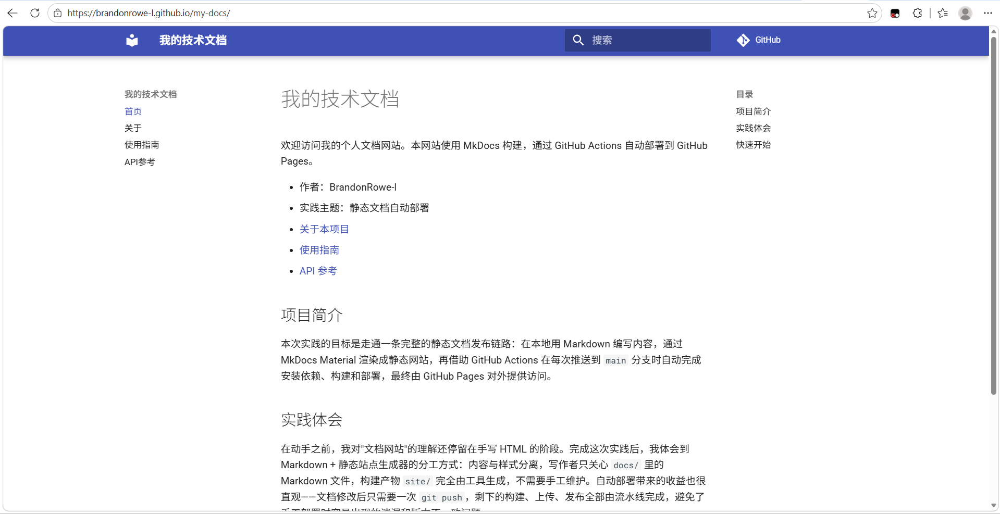
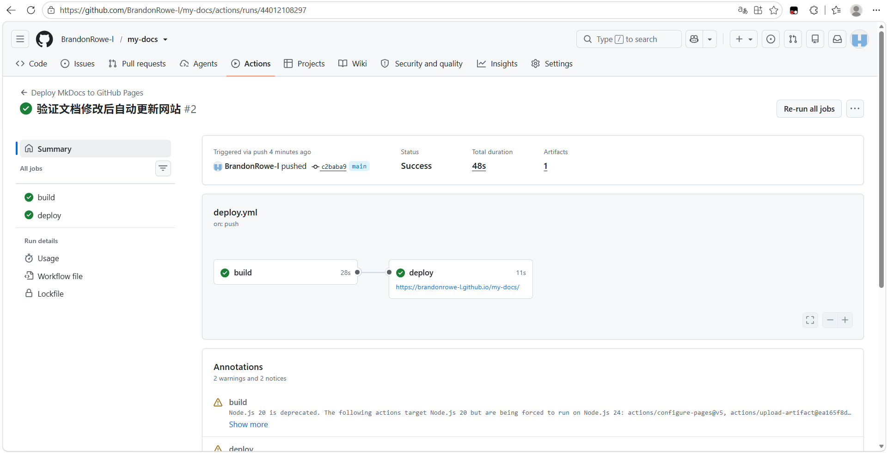
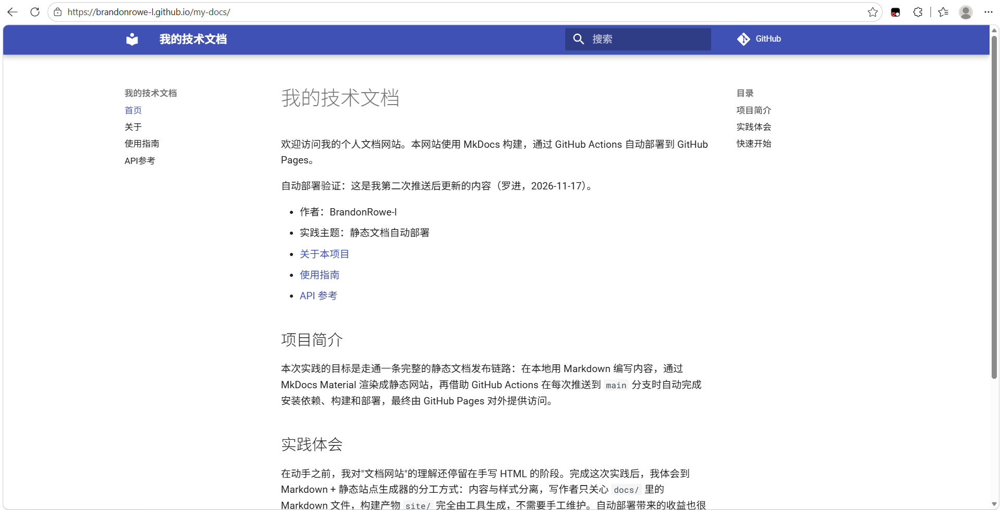

# 实践项目2：个人实验报告

## 1. 基本信息

- GitHub 登录名：BrandonRowe-l
- 个人仓库地址：<https://github.com/BrandonRowe-l/my-docs>
- 最终网站地址：<https://brandonrowe-l.github.io/my-docs/>

## 2. 实践过程与关键截图

### 2.1 仓库创建

说明：登录 GitHub，使用本人账号新建公开仓库 `my-docs`（创建时勾选 README，默认分支为 `main`）。本地项目目录用 `git init` 初始化后，先 fetch 远程初始提交并对齐历史，再把全部项目文件作为新提交推送到 `main`，保证远程提交历史连续、无需强推。

### 2.2 项目结构与 MkDocs 配置

说明：在仓库根目录创建 `docs/`（四页 Markdown 内容）、`report/`（本报告与截图）、`mkdocs.yml`（站点配置）等。截图为 GitHub 仓库的文件树与 `mkdocs.yml` 全文。

- `docs/` 存放网站内容的 Markdown 源文件，是唯一需要手工编写的内容目录。
- `mkdocs.yml` 中的 `nav` 定义站点导航，路径相对 `docs/` 书写。
- `site/` 是 `mkdocs build` 自动生成的构建产物，不手工修改、不提交仓库。

### 2.3 本地构建或预览

说明：在独立虚拟环境（Python 3.11）中安装依赖后执行 `python -m mkdocs build --strict`，构建成功且无警告（`Documentation built in 0.34 seconds`）；再用 `python -m mkdocs serve` 启动本地预览。由于配置了 `site_url`，预览地址为 `http://127.0.0.1:8000/my-docs/`。逐页检查了首页、关于、使用指南、API 参考的导航、表格、代码块和页面间链接。截图保留地址栏，以证明是本地预览而非线上网站。

### 2.4 Pages 设置

说明：在仓库 `Settings` → `Pages` → `Build and deployment` → `Source` 中选择 **GitHub Actions**，将发布来源设置为官方 Pages 工作流（页面提示 "GitHub Pages source saved."）。设置之前首次运行的 `Configure Pages` 步骤曾因此失败，设置来源并重跑后成功，详见第 3 节。

### 2.5 Actions 首次构建和部署

说明：首次推送后，工作流 `Deploy MkDocs to GitHub Pages` 自动运行；设置 Pages 来源并重跑后，`build` 与 `deploy` 两个任务均成功（build 16s、deploy 9s）。运行记录：<https://github.com/BrandonRowe-l/my-docs/actions/runs/44009276331>。Annotations 中的 Node.js 20 弃用提示仅为警告，不影响构建与部署结果。

### 2.6 网站访问与四页导航检查

说明：访问 `https://brandonrowe-l.github.io/my-docs/`，已逐一打开首页、关于、使用指南、API 参考四个页面，确认导航、样式与链接正常（截图保留浏览器地址栏）。

### 2.7 第二次推送与自动更新验证

说明：在 `docs/index.md` 中新增一句本人编写的验证文字："自动部署验证：这是我第二次推送后更新的内容（罗进，2026-11-17）。" 本次只修改 `docs/index.md`，不做任何手动触发，推送后由 `push` 事件自动触发新一轮工作流（运行的 event 为 push）；运行成功后刷新网站，确认新增文字已出现。

- 对应提交链接：<https://github.com/BrandonRowe-l/my-docs/commit/c2baba9e5f382bf08ed505cf68a1cb931b918a6b>
- 对应 Actions 运行链接：<https://github.com/BrandonRowe-l/my-docs/actions/runs/44012108297>

## 3. 问题与解决

**问题 1：首次运行在 `Configure Pages` 步骤失败，deploy 被跳过。**

- 现象：首次推送触发的运行（run 44009276331 第 1 次尝试）中 `build` 任务失败、`deploy` 为 skipped，失败步骤为 `Configure Pages`。
- 原因：仓库 `Settings` → `Pages` 的发布来源尚未设置为 GitHub Actions，`actions/configure-pages` 无法取得 Pages 部署所需的配置与权限。
- 解决操作：在 `Settings` → `Pages` → `Source` 选择 **GitHub Actions** 并保存，然后在该运行页点击 Re-run 重跑；第 2 次尝试 build、deploy 全部成功（见截图④⑤）。
- 核对：对比同一 run 两次尝试的步骤结论，并确认 Pages 设置页显示 "GitHub Pages source saved."。

**问题 2：第二次推送时本地到 github.com 的连接被重置。**

- 现象：`git push` 报 `RPC failed; curl 28 ... Could not connect to server` 与 `Recv failure: Connection was reset`，提交未到达远程（远程 main 仍停留在第一次提交，也未触发新运行）。
- 原因：本机网络直连 github.com:443 不稳定（api.github.com 同时可正常访问），属本地网络链路问题，与仓库配置无关。
- 解决操作：不修改全局 Git 配置，仅对本次推送临时指定本机代理与 HTTP/1.1：`git -c http.proxy=http://127.0.0.1:7890 -c http.version=HTTP/1.1 push origin main`，推送成功并自动触发新运行。
- 核对：推送后用 GitHub API 确认远程 main 已更新为第二次提交、且新运行的 event 为 push。

此外核对了两次成功运行的全部步骤结论与 Annotations：除 Node.js 20 弃用警告（仅提示、不影响结果）外无其他告警；`mkdocs build --strict` 在本地与 Actions 中均零警告通过。

## 4. 原理理解

1. **docs/ 和 site/ 各保存什么？为什么不用手工修改 site/？**

   `docs/` 保存 Markdown 源文件，是人工编写和维护的内容；`site/` 是 `mkdocs build` 把 `docs/` 渲染后生成的静态 HTML 等产物。因为 `site/` 完全由构建工具根据源文件和 `mkdocs.yml` 自动生成，每次构建都会重新覆盖，手工修改会在下一次构建时丢失，所以只需要维护 `docs/`，不需要也不应该手工修改 `site/`。

2. **本次工作流在什么情况下自动运行？**

   当有新的 `push` 到 `main` 分支，且改动的文件路径命中 `paths` 列表（`docs/**`、`mkdocs.yml`、`requirements.txt`、`.github/workflows/deploy.yml`）时自动运行；此外也可以在 Actions 页面通过 `workflow_dispatch` 手动触发。

3. **build 与 deploy 两个任务有什么区别？**

   `build` 任务负责取源码、配置 Python 环境、安装依赖、执行 `mkdocs build --strict` 并把 `site/` 上传为 artifact，它只产出构建产物；`deploy` 任务通过 `needs: build` 依赖前者，在构建成功后取得该 artifact，并使用官方 `actions/deploy-pages` 把它发布到 GitHub Pages 环境，使网站真正对外可见。两者职责分离：一个产出，一个发布。

4. **只修改 report/README.md 会触发部署吗？为什么？**

   不会。工作流的 `push` 触发器限定了 `branches: [main]` 和 `paths` 列表，`report/README.md` 不在命中的路径中，因此这次推送不会触发工作流；网站内容保持不变。这也是预期行为——报告属于仓库文档而非网站内容。

5. **本次方案为何无需创建 gh-pages 分支？**

   因为使用的是 GitHub 官方 Pages Actions 部署方式：`actions/upload-pages-artifact` 把 `site/` 作为构建产物上传，`actions/deploy-pages` 直接把该 artifact 部署到 `github-pages` 环境，发布由 Actions 完成，不依赖从某个分支读取静态文件，所以无需创建和维护 `gh-pages` 分支。
